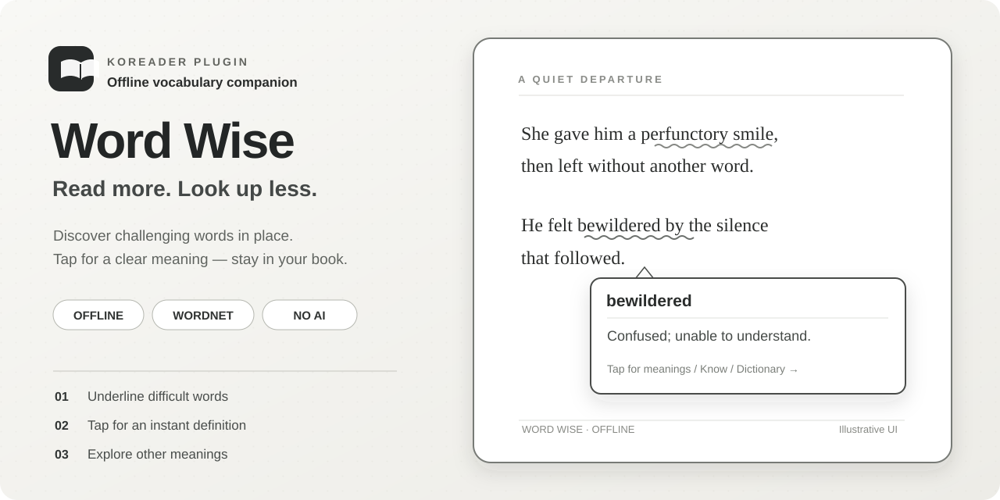
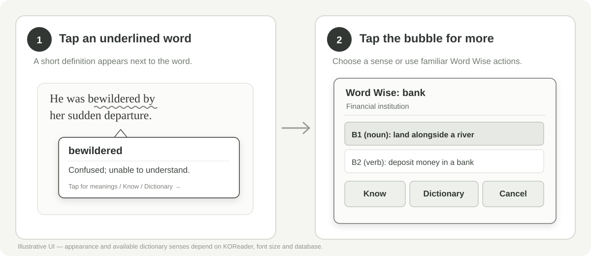
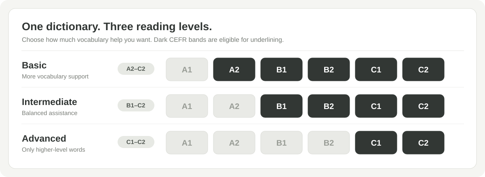

# Word Wise for KOReader

**Read more. Look up less. Understand more.**

Word Wise is an offline vocabulary companion for **KOReader on Android**. It provides **two display modes**: **Inline hints** show tiny WordNet definition excerpts above difficult words, while **Tap to define** underlines them and shows a nearby bubble when tapped. Both modes use the same offline dictionary, selected senses, CEFR filters and known-word list.

**Latest:** [v0.2.15 — Dual Display](https://github.com/trigon1998/wordwise.koplugin/releases/tag/v0.2.15) · **English definitions** · **No AI or API key** · **Offline reading**



*Illustrative concept of the v0.2.14 reading experience — not a screenshot captured on a real KOReader device.*

## Display modes and glanceable inline hints

From an open book, use **More tools → Word Wise → Display mode** to switch:

| Setting | Behavior |
| --- | --- |
| **Tap to define** (default) | Underline difficult words; tap one for a short popup, then tap that bubble for more meanings. No extra line spacing. |
| **Inline hints** | Show very short English meaning snippets above difficult words. Tap a hint or its word for the complete multi-sense dialog. |

Your choice is **saved per book**. The chosen CEFR level, WordNet dictionary and known-word list are shared.

**Inline detail** (shown only for Inline hints) controls how much text appears:

- **Micro** (default): up to **4 words / 34 characters**.
- **Short**: up to **6 words / 50 characters**.

Rather than guessing a synonym, these microglosses are **extractive snippets of the existing selected WordNet sense**. A trailing ellipsis tells you that the full definition contains more information. Tap the hint whenever you need the complete meaning. This keeps the plugin offline, fast and transparent about ambiguity.

## Features

| Feature | Description |
| --- | --- |
| **Two display modes** | Choose **Inline hints** or **Tap to define** separately for each book. |
| **Inline microglosses** | Get an extractive 4-word definition snippet above a word, or choose up to 6 words. |\n| **Tap to define** | See a short English explanation beside an underlined word. |
| **Multiple meanings** | Choose among locally stored WordNet senses and remember your preference. |
| **Reading levels** | Basic, Intermediate and Advanced determine how many words are marked. |
| **Know / Show** | Hide words you know; restore them whenever you need. |
| **Offline-first** | Word lookup requires no internet connection, AI model, or API key. |
| **OTA updates** | Check GitHub releases from KOReader and verify release ZIP files using SHA-256. |

The local SQLite dictionary combines **CEFR-J** and **Octanove** word-level profiles with **Open English WordNet** explanations. Word Wise does not automatically translate words or infer the correct meaning from a sentence.

## How it works



*UI illustration. Real fonts, layout, available senses, and button sizes depend on your KOReader build and dictionary.*

1. **Choose a display mode:** Inline hints or Tap to define.
2. **In Tap mode:** Tap an underlined word for a nearby offline definition.
3. **In Inline mode:** Read the very short hint at a glance, or tap it to open the Word Wise dialog with other meanings, **Know/Show** and **Dictionary**.

Normal taps on unmarked text still go to KOReader's reading controls. A tap outside an open bubble dismisses it without simultaneously turning the page.

## Choose your reading level



| Mode | CEFR bands eligible for underlining | Recommended for |
| --- | --- | --- |
| **Basic** | A2, B1, B2, C1, C2 | More vocabulary guidance |
| **Intermediate** | B1, B2, C1, C2 | Balanced help (**default for new users**) |
| **Advanced** | C1, C2 | Only higher-level vocabulary |

These are **reader proficiency modes**, not three exclusive sets of words. The original six CEFR values remain in the database and dictionary popup. Previous A1/A2 settings map to Basic, B1/B2 to Intermediate, and C1/C2 to Advanced; existing preferences are not deleted.

## Install / update on Android

### Updating an existing installation

1. Open a reflowable book in KOReader and select **More tools → Word Wise → Updates → Check for updates**.
2. Choose [**v0.2.15**](https://github.com/trigon1998/wordwise.koplugin/releases/tag/v0.2.15), review the notes, and confirm the update and restart.
3. Enable Word Wise, choose **Display mode → Inline hints / Tap to define**, and set your Reading level.

The updater verifies the release ZIP against its published SHA-256 checksum before installation. The network is needed for **checking and downloading updates only** — word lookups stay offline.

### Fresh installation

1. Download [**wordwise.koplugin.zip**](https://github.com/trigon1998/wordwise.koplugin/releases/latest).
2. Extract the ZIP; the folder must be named exactly `wordwise.koplugin`.
3. Copy the directory into the KOReader plugins folder, usually `koreader/plugins/`.
4. Restart KOReader, open a reflowable book, and enable **More tools → Word Wise → Enable Word Wise** and select your display mode.

> **Important:** This is a KOReader plugin, not an Android APK. `main.lua` and `wordwise.db` should sit directly inside `wordwise.koplugin/`.

## Multiple meanings and saved words

Every dictionary entry stores a concise bubble definition (`short_def`), full meaning (`full_def`), part of speech, CEFR label, and a stable `sense_key`. You can select an alternative meaning without AI or contextual inference.

Marking **Know** removes underlines for that lemma, including other occurrences or inflected forms where its dictionary lookup resolves to that lemma. Your word list and preferred senses are separate from the plugin and persist across OTA updates:

| KOReader data file | Saved information |
| --- | --- |
| `wordwise/known_words.lua` | Known words |
| `wordwise/state.lua` | Manually selected meanings |
| Book-specific settings | Whether Word Wise is enabled in the current book |

Use **Word Wise → Known words file** to find the data directory. Optionally override the bundled dictionary with a compatible `wordwise.db` in that data folder.

**Line spacing:** Tap mode retains the book's original spacing. Inline mode temporarily raises it to accommodate hints; returning to Tap mode or disabling Word Wise restores the saved value unless the reader deliberately changed it.

## Compatibility and limitations

- Works with **reflowable/crengine** formats, such as EPUB, on compatible KOReader builds.
- **Fixed-layout PDF and DjVu** books are not currently supported by the underline overlay.
- Word lookup is **offline**. Release checks and OTA downloads require internet.
- Does **not** provide AI-assisted context selection, phrase/idiom inference, or automatic translation to Vietnamese.
- Touch-zone customizations and other overlay plugins may need a compatibility check on the physical device.

## Database and development

The canonical local dictionary uses the following SQLite schema:

```sql
CREATE TABLE entries (
    id         INTEGER PRIMARY KEY,
    word       TEXT NOT NULL COLLATE NOCASE,
    short_def  TEXT NOT NULL,
    full_def   TEXT NOT NULL,
    cefr_level TEXT NOT NULL CHECK(cefr_level IN ('A1','A2','B1','B2','C1','C2')),
    pos        TEXT,
    sense_key  TEXT NOT NULL UNIQUE,
    source     TEXT
);

CREATE INDEX entries_word_idx ON entries(word COLLATE NOCASE);
CREATE INDEX entries_cefr_idx ON entries(cefr_level);
```

Build the dictionary with the provided CEFR-J, Octanove, curated glossary and WordNet source files:

```sh
cd tools
python3 build_cefr_wordnet_dict.py \
  --cefrj cefrj-vocabulary-profile-1.5.csv \
  --octanove octanove-vocabulary-profile-c1c2-1.0.csv \
  --glosses open_glosses.tsv \
  --out ../wordwise.db
```

The builder keeps existing curated definitions, adds WordNet senses for mapped lemmas, and skips words without an audited CEFR level. See the [developer guide](DEVELOPMENT.md) for implementation, tests and OTA internals.

## Data, attribution and licensing

This project is based on [asxelot/wordwise.koplugin](https://github.com/asxelot/wordwise.koplugin) and is optimized for KOReader on Android. The fork removes Kindle/Amazon corpus detection and conversion.

The dictionary includes **CEFR-J Vocabulary Profile 1.5** (CEFR-J project and Tono Laboratory, Tokyo University of Foreign Studies), **Octanove Vocabulary Profile C1/C2 1.0** (CC BY-SA 4.0), **Open English WordNet 2024**, and project-curated entries in [`tools/open_glosses.tsv`](tools/open_glosses.tsv).

The upstream project has no clearly recognized GitHub license. Before redistributing modified upstream code or assets, confirm the original author's permissions and respect each dictionary source's license.

---

[**Latest release**](https://github.com/trigon1998/wordwise.koplugin/releases/latest) · [**v0.2.15 release notes**](https://github.com/trigon1998/wordwise.koplugin/releases/tag/v0.2.15) · [**Development guide**](DEVELOPMENT.md)
