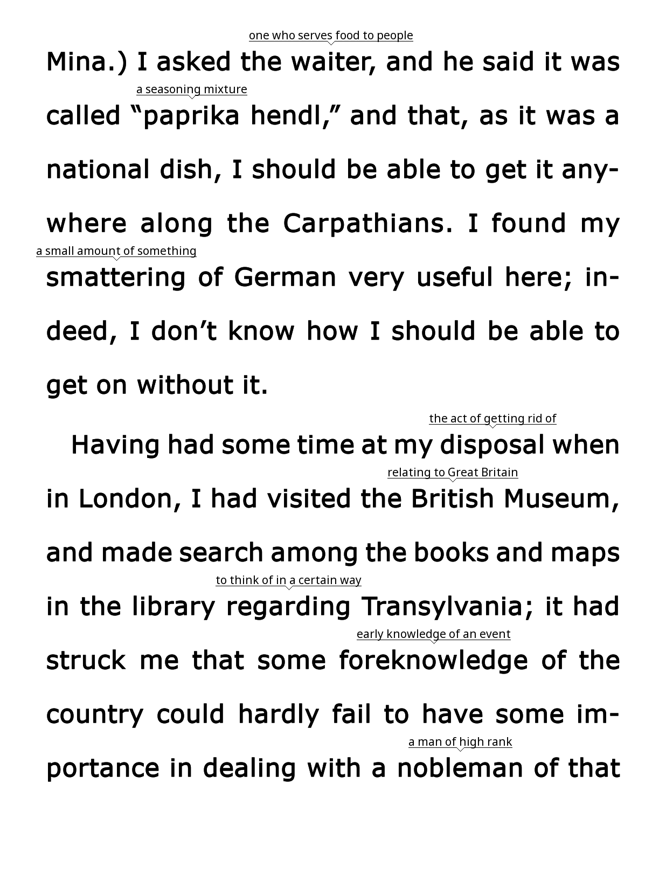

# Word Wise for KOReader — Android CEFR fork

This fork is based on [asxelot/wordwise.koplugin](https://github.com/asxelot/wordwise.koplugin) and is optimized for **KOReader on Android**. It underlines difficult words and shows short offline definitions when you tap them. It never rewrites the book file.

The fork removes Kindle/Amazon corpus detection and conversion. Its bundled data is built from the open CEFR-J and Octanove vocabulary profiles plus Open English WordNet definitions. The project keeps upstream attribution and records the data sources used by the build tools.



## Install on Android

1. Download the release ZIP and unzip it as `wordwise.koplugin`.
2. Copy the folder to the KOReader plugins directory, normally `koreader/plugins/`.
3. Restart KOReader.
4. Open a reflowable book and select **☰ → More tools → Word Wise → Underline difficult words**.

Word Wise can update itself from signed-off GitHub release assets via **Word
Wise → Updates**. It shows the release notes before installation, verifies the
ZIP against its published SHA-256 checksum, and offers to restart KOReader when
the atomic installation succeeds. The optional wake-time notification only
checks release metadata; it never installs an update automatically.

The plugin targets reflowable/crengine documents. Paging/fixed-layout documents are not currently supported because the overlay needs KOReader’s visible-word and screen-box APIs.

## Offline Word Sense: reading levels

The plugin uses its existing local CEFR + WordNet SQLite database only:
**no AI, network connection, API key or contextual inference**.

Choose **Reading level** in the Word Wise menu:

| Reader proficiency | Words marked (CEFR) | Behavior |
| --- | --- | --- |
| Basic | A2–C2 | Most vocabulary help |
| Intermediate | B1–C2 | Balanced; default for new users |
| Advanced | C1–C2 | Only higher-level words |

The original six CEFR labels remain in the database and sense picker. Old
`wordwise_cefr_level` settings are mapped non-destructively: A1/A2 → Basic,
B1/B2 → Intermediate, and C1/C2 → Advanced. A user-chosen Reading level
takes precedence.

## Underline and tap to define

Words meeting the proficiency threshold get a subtle wavy underline.
**Tap an underlined word** to see its short WordNet meaning in a nearby
bubble, without changing the book's line spacing. **Tap the bubble** to
open the existing action dialog, which lists alternative senses and offers
**Know/Show**, **Dictionary** and **Cancel**.

As before, a selected sense is remembered for the lemma. Marking a word
as known hides its underlines; selected meanings and known words are stored
outside the plugin directory and survive updates. A tap on unmarked text
passes through to normal KOReader controls. Tapping away while a bubble is
open dismisses it without also turning the page.

When upgrading from older inline-gloss releases, the plugin restores the
original per-book line spacing if it had been increased by Word Wise
and the reader has not manually changed that setting.

## Database schema

The fork reads this schema:

```sql
CREATE TABLE entries (
    id         INTEGER PRIMARY KEY,
    word       TEXT NOT NULL COLLATE NOCASE,
    short_def  TEXT NOT NULL,
    full_def   TEXT NOT NULL,
    cefr_level TEXT NOT NULL CHECK(cefr_level IN ('A1','A2','B1','B2','C1','C2')),
    pos        TEXT,
    sense_key  TEXT NOT NULL UNIQUE,
    source     TEXT
);

CREATE INDEX entries_word_idx ON entries(word COLLATE NOCASE);
CREATE INDEX entries_cefr_idx ON entries(cefr_level);
```

A user database placed at `<koreader data dir>/wordwise/wordwise.db` overrides the bundled database. User choices are stored separately in `<koreader data dir>/wordwise/known_words.lua` and `<koreader data dir>/wordwise/state.lua`, outside the plugin folder. Updating or replacing `wordwise.koplugin` therefore does not remove the known-word list. The Word Wise menu includes **Known words file** to show the exact path. The runtime also accepts the upstream `difficulty` schema as a temporary compatibility path and maps its five bands approximately to CEFR.

## Building the dictionary

The preferred build uses the open CEFR-J and Octanove profiles together with Open English WordNet:

```sh
cd tools
python3 build_cefr_wordnet_dict.py \
  --cefrj cefrj-vocabulary-profile-1.5.csv \
  --octanove octanove-vocabulary-profile-c1c2-1.0.csv \
  --glosses open_glosses.tsv \
  --out ../wordwise.db
```

The builder preserves curated rows from `open_glosses.tsv`, adds multiple WordNet senses for CEFR-mapped lemmas, and never invents a CEFR level. It generates the compact `short_def` while retaining the original source definition in `full_def`. Gloss rows without an audited CEFR mapping are reported and skipped.

To build only from curated glosses, use `build_cefr_dict.py`. The removed upstream Zipf difficulty pipeline is intentionally not part of this fork’s release build.

## Data and attribution

The bundled dictionary uses:

- CEFR-J Vocabulary Profile 1.5, provided by the CEFR-J project and Tono Laboratory at Tokyo University of Foreign Studies.
- Octanove Vocabulary Profile C1/C2 1.0, used under its stated CC BY-SA 4.0 terms.
- Open English WordNet 2024 definitions.
- Project-curated glosses in `tools/open_glosses.tsv`.

Review the upstream repository’s licensing status before publishing a redistributed fork. The upstream repository does not expose a recognized GitHub license, so attribution and permission should be clarified with the original author before distributing modified upstream code or assets.

## Compatibility and stability notes

The overlay currently supports reflowable/crengine documents, including
EPUB where KOReader exposes visible-word and screen-box APIs. Fixed-layout
PDF/DjVu support is not included in this fork.

Grapheme layout and underlines use KOReader's screen-box coordinates.
The full-screen priority tap zone handles only matched words or dismissal
of an already open bubble, so other taps preserve normal page turns.
Font, margin, and layout changes trigger re-enumeration of the visible
word positions. The offline database schema and updater are unchanged.
